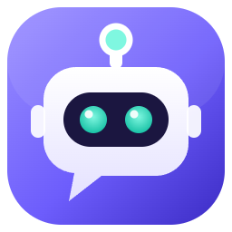

# Free Discord Bot

Hello, my name is Yeri, and I'm making a Discord bot inspired by MEE6, and it's **100% free**!

Unlike the MEE6 bot, my bot is **open source** and you can download it from GitHub.
You run it on your own computer and manage it from a desktop app, in Hebrew, English, Russian or Arabic.

You can also connect the bot to the **Claude API** and talk with it using the model of your choice:
**Haiku**, **Sonnet** or **Opus**. I recommend **Haiku**, because it uses the fewest credits.

Prefer **ChatGPT** or **Grok**? Add an OpenAI or xAI API key instead and pick the provider on the AI Chat page.

> **About cost:** the Claude API is billed separately from Claude Pro / Max subscriptions (the same goes for the
> OpenAI and xAI APIs vs ChatGPT Plus / X Premium).
> To use it you need API credits in the [Anthropic Console](https://console.anthropic.com/). Haiku is very cheap,
> and the app shows an estimated cost and lets you set a daily limit.

You can also ask it to do things inside the server, for example:
- `@ClaudeBot timeout User12345`
- `@ClaudeBot rename the chat to "💬│chat" and apply the same style to all channels, for example "🎧│VoiceChat" / "🗣️│Announce"`
- `@ClaudeBot delete all the messages that include bad words (like "idiot")`

Before doing anything, the bot shows exactly what it is going to do and waits for you to click **Confirm**.
It only listens to the user ID you allowed, and only does what that user has permission to do in the server.
(Turn this on in the app: **AI → Chat with Claude → Let Claude perform actions in the server**.)

You can also just **reply** to the bot instead of mentioning it every time.

**No Claude API? Don't worry:** the bot works just as well without it. Claude is only needed for the chat.

(You can name the bot however you want. `@ClaudeBot` and `User12345` were just examples.)

---

## What it can do

| Category | Modules |
|---|---|
| Essentials | Welcome & Goodbye (text or embed), Auto Role, Reaction Roles, AutoMod (10 rules, each with its own action), Warnings with automatic escalation, Restricted Channels, Moderation commands with confirm buttons, Audit Log, Levels (XP, role rewards, `/rank`, `/levels`), Starboard |
| Server Management | Custom Commands like MEE6 (real slash commands or `!text`, variables like `{args}`, `{random}`, `{choose:a\|b}`, delete the trigger message, give or remove roles), Invite Tracker, Tickets (private threads), Suggestion Box |
| Automations | WHEN someone… IF… DO…: 11 events, 20 conditions, 12 actions, buttons, retry on failure |
| Utilities | Polls (Discord's own), Embed Message builder with live preview and **Publish**, Reminders (repeating + `/remind`), Statistics Channels, Temporary Voice Channels, AFK |
| Social Alerts | YouTube, Twitch, Reddit and any RSS feed (TikTok and X have no free API, so they are not supported) |
| Games & Fun | Economy (currency, `/daily` streaks, dice, guess, roulette, rock-paper-scissors, shop, boosts), Giveaways, Birthdays |
| AI Character | Make the AI talk as any character, per server: just type a name (Deadpool, a comedian, a historical figure) or fill in a full profile (bio, traits, loves, hates, facts) with sliders for answer length, demeanor, vulgarity and content, plus a test chat. Real people are played as parody |
| AI | Chat with **Claude** (Haiku / Sonnet / Opus), **ChatGPT** (GPT-6 Luna / Terra / Sol / Astra) or **Grok** (4.3 / 4.7), all with the same powers: server actions with confirmation, saves birthdays / reminders / giveaways / polls you mention (after you confirm) |
| Multi-server | Each server keeps its own settings and stats. The bot can have a **different nickname, picture, banner and bio in each server**, and you can run **several bot accounts** (each with its own token) from one app and choose which bot runs each server |
| App | Bot Personalizer (avatar, banner, status, activity), **Console** (typed commands + talk as the bot), **Customize everything** (every bot message, embed colors and emojis per server, slash command names, app theme and custom CSS), per-server profiles, invite link builder with minimal permissions, live logs, Ctrl+K search, online updates with rollback |

Tell the bot "John's birthday is on 24/12" and it offers to add it to Birthdays; it saves it only after you click
**Confirm** or type "yes". It can also answer questions like "who talks the most here?" from its own message count.

**Missing intents?** The app has a **Turn on automatically** button that switches on the Server Members and Message
Content intents through Discord's API (works for bots in fewer than 100 servers) and reconnects the bot.

## Install (Windows)

1. Install [Python 3.13 or newer](https://www.python.org/downloads/).
2. Download this repository (green **Code** button → **Download ZIP**) and unzip it.
3. Double-click **`setup.cmd`** (first time only).
4. Double-click **`start.cmd`**.
5. In the app, open **Connection & Settings** and paste your own **Bot Token**
   (from the [Discord Developer Portal](https://discord.com/developers/applications)),
   and optionally your **Anthropic API key** and your **Discord user ID**.

Your token and API key are stored in **Windows Credential Manager**, never in files or in git.
Hebrew guide: [README.he.md](README.he.md).

## Updates

The app's **Updates** page checks this repository's Releases. The newest version is offered as an update,
and every older version can be installed again ("go back"). A backup of your current version is kept,
and your settings and data are not touched.

> [!WARNING]
> **Always use the newest version.** Every release fixes bugs and adds safety checks, so the bot works better and
> more safely in newer versions. Going back to an older version, or trying the first releases, can put your server
> at risk: those versions have bugs that were fixed later and may make the bot behave in unexpected ways in your
> server. For example:
> - In 1.0.0–1.0.2 the in-app update cannot download new versions (you have to download the newest one by hand).
> - Before 1.0.2, personal reminders could crash, and the missing-intents problem could only be fixed by hand.
>
> If you go back anyway, do it at your own risk, and update again as soon as you can.

Maintainers publish a version with `python tools/release.py 1.0.1 "what changed"`. Older release zips are moved
into the `OldVersions` folder.

## License

MIT. See [LICENSE](LICENSE).
